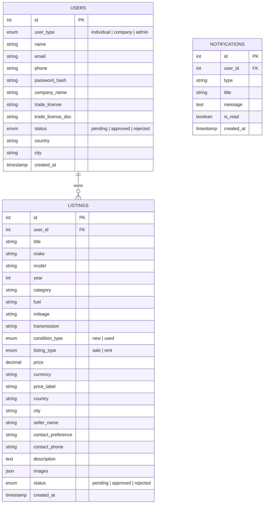

# 🗄️ BinmarDrive — Database Schema & Architecture

BinmarDrive is architected to operate with **MySQL 8.0+** using `utf8mb4` character encoding, supported by an automatic **zero-configuration in-memory fallback layer**.

---

## 🏛️ Architecture Overview

---

## 📋 Table Specifications

### 1. `users` Table
Stores authentication credentials, contact information, user types, and commercial trade license details for dealerships.

| Column | Type | Nullable | Default | Description |
| :--- | :--- | :--- | :--- | :--- |
| `id` | `INT AUTO_INCREMENT` | No | — | Primary Key |
| `user_type` | `ENUM('individual','company','admin')` | No | `'individual'` | Role and permission tier |
| `name` | `VARCHAR(255)` | No | — | Full contact name or dealership contact |
| `email` | `VARCHAR(255)` | Yes | `NULL` | Unique email for authentication |
| `phone` | `VARCHAR(50)` | Yes | `NULL` | Primary phone/WhatsApp number |
| `password_hash` | `VARCHAR(255)` | Yes | `NULL` | bcrypt password hash |
| `company_name` | `VARCHAR(255)` | Yes | `NULL` | Commercial legal name (if dealer) |
| `trade_license` | `VARCHAR(255)` | Yes | `NULL` | Official license registration number |
| `trade_license_doc`| `VARCHAR(255)` | Yes | `NULL` | Path to uploaded verification document |
| `status` | `ENUM('pending','approved','rejected')`| No | `'approved'` | Approval status (`pending` for new companies) |
| `country` | `VARCHAR(100)` | Yes | `'United Arab Emirates'` | Operating country |
| `city` | `VARCHAR(100)` | Yes | `NULL` | Operating city |
| `created_at` | `TIMESTAMP` | Yes | `CURRENT_TIMESTAMP` | Account registration timestamp |

---

### 2. `listings` Table
Stores all vehicle inventory, both for direct sale and for daily/weekly/monthly rental.

| Column | Type | Nullable | Default | Description |
| :--- | :--- | :--- | :--- | :--- |
| `id` | `INT AUTO_INCREMENT` | No | — | Primary Key |
| `user_id` | `INT` | Yes | `NULL` | Foreign key referencing `users.id` |
| `title` | `VARCHAR(255)` | No | — | Headline title (e.g. *2024 Toyota Land Cruiser*) |
| `make` | `VARCHAR(100)` | No | — | Brand (Toyota, Nissan, Porsche, etc.) |
| `model` | `VARCHAR(100)` | No | — | Model name |
| `year` | `INT` | No | — | Model manufacture year |
| `category` | `VARCHAR(50)` | No | — | Body style: `SUV`, `Sedan`, `Luxury`, `Pickup` |
| `fuel` | `VARCHAR(50)` | Yes | `'Petrol'` | Fuel type (`Petrol`, `Diesel`, `Hybrid`, `Electric`) |
| `mileage` | `VARCHAR(50)` | Yes | `'0 km'` | Odometer reading string |
| `transmission` | `VARCHAR(50)` | Yes | `'Automatic'` | `Automatic` or `Manual` |
| `condition_type` | `ENUM('new', 'used')` | No | `'new'` | Condition classification |
| `listing_type` | `ENUM('sale', 'rent')` | No | `'sale'` | Transaction type |
| `price` | `DECIMAL(12,2)` | No | `0.00` | Numeric value used for range filtering |
| `currency` | `VARCHAR(10)` | Yes | `'AED'` | `AED`, `SAR`, `QAR`, `OMR`, `KWD`, `BHD` |
| `price_label` | `VARCHAR(100)` | Yes | `NULL` | Formatted display price (e.g. *AED 385,000* or *OMR 45 / day*) |
| `country` | `VARCHAR(100)` | No | — | Country of vehicle location |
| `city` | `VARCHAR(100)` | No | — | City of vehicle location |
| `seller_name` | `VARCHAR(255)` | No | — | Individual or verified showroom name |
| `contact_preference`| `VARCHAR(50)` | Yes | `'WhatsApp'` | Contact mode: `'WhatsApp'` or `'Phone call'` |
| `contact_phone` | `VARCHAR(50)` | Yes | `NULL` | Direct contact number with country code |
| `description` | `TEXT` | Yes | `NULL` | Full specifications and condition notes |
| `images` | `JSON` | Yes | `NULL` | Array of image URLs or file upload paths |
| `status` | `ENUM('pending','approved','rejected')` | No | `'pending'` | Moderation state |
| `created_at` | `TIMESTAMP` | Yes | `CURRENT_TIMESTAMP` | Submission timestamp |

#### Indices
- `idx_status`: Index on `status` (fast queries for approved public listings)
- `idx_make`: Index on `make`
- `idx_country`: Index on `country`
- `idx_type`: Index on `listing_type` (`sale` vs `rent`)

---

### 3. `notifications` Table
Stores actionable event notifications for the platform administrator and sellers.

| Column | Type | Nullable | Default | Description |
| :--- | :--- | :--- | :--- | :--- |
| `id` | `INT AUTO_INCREMENT` | No | — | Primary Key |
| `user_id` | `INT` | Yes | `NULL` | Recipient user ID (NULL for general admin alerts) |
| `type` | `VARCHAR(50)` | Yes | `'info'` | Category: `'dealer'`, `'listing'`, `'system'` |
| `title` | `VARCHAR(255)` | No | — | Brief notification headline |
| `message` | `TEXT` | No | — | Full notification body |
| `is_read` | `BOOLEAN` | Yes | `FALSE` | Read state boolean |
| `created_at` | `TIMESTAMP` | Yes | `CURRENT_TIMESTAMP` | Alert creation timestamp |

---

## 🔄 In-Memory Fallback Mechanism

Implemented in `backend/db.js`:
- If the MySQL connection fails on server boot (e.g., MySQL service not yet started), the module seamlessly initializes an **in-memory data structure** (`memoryState`).
- The fallback intercepts and responds to standard SQL operations (`SELECT`, `INSERT`, `UPDATE`, `JOIN`).
- This enables:
  - Immediate local development without installing MySQL.
  - Zero-friction demo deployment and testing.
  - Seamless switchover: whenever a valid MySQL connection is supplied in `backend/.env`, restart the server to store directly in MySQL.
